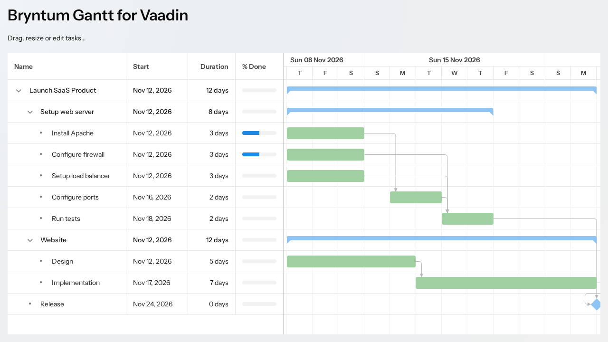

# Bryntum Gantt for Vaadin

A Vaadin add-on wrapping [Bryntum Gantt](https://bryntum.com/products/gantt/). Since Bryntum 8, the Community tier of
Bryntum Gantt is MIT licensed and published to the public npm registry, so the add-on works out of the box: the
`@bryntum/gantt-community` npm package is pulled in automatically by the Vaadin build, nothing needs to be
downloaded manually.



Requirements: Vaadin 25+, Java 21+.

## Usage

```java
GanttChart gantt = new GanttChart();

Task launch = gantt.addTask("Launch SaaS Product");
Task webServer = launch.addChild("Setup web server");
Task apache = webServer.addChild("Install Apache", LocalDate.now(), 3);
apache.setPercentDone(50);
Task ports = webServer.addChild("Configure ports", LocalDate.now(), 2);

gantt.addDependency(apache, ports).setLag(1);

// Edits made in the browser (drag, resize, cell & task editing) are synchronized
// to the Task objects, and rescheduled tasks are reported as well
gantt.addTasksChangedListener(e -> e.getTasks().forEach(task -> saveToDb(task)));
gantt.addTasksRemovedListener(e -> e.getTasks().forEach(task -> deleteFromDb(task)));

add(gantt);
```

Other features of the Java API:

* `setColumns(Column.wbs(), Column.name(), Column.startDate(), Column.of("enddate").withWidth(120))` - define grid columns
* `setReadOnly(true)` - disable editing
* `zoomToFit()`, `scrollToTask(task)`, `setZoomToFitOnLoad(false)`
* `addTask`, `removeTask`, `addDependency`, `removeDependency`, `findTask(id)`
* `refresh()` - push changes to the browser after modifying `Task`/`Dependency` objects directly

The server side model is the source of truth. Adding tasks, creating dependencies and re-parenting tasks in the
browser are disabled for now, those are done via the Java API.

Note that the Community tier contains a subset of Bryntum Gantt features (see the
[feature table](https://www.npmjs.com/package/@bryntum/gantt-community)). Features like the full task editor,
critical paths, baselines or PDF export require a commercial Bryntum license and the `-core`/`-enterprise` packages.

## Development

Run the `TestServer` class (in `src/test/java`) from your IDE and open http://localhost:8080/. The usage examples
(`BasicGanttUsageUI`, `DynamicGanttUI`) are listed there.

* `mvn test` runs the unit tests
* `mvn verify` runs also the browser tests (Playwright, headless). Add `-Dheadful` to see the browser.

Note, Vaadin 25.3+ installs npm packages with `--min-release-age=1`, so a Bryntum version released less than a day ago
can't be installed by the Vaadin build. Run `npm install` manually in the project directory if you hit that.

## Installation

```xml
<dependency>
    <groupId>in.virit</groupId>
    <artifactId>bryntum-gantt-vaadin</artifactId>
    <version>1.0.0</version>
</dependency>
```

## License

The integration code is licensed under the [Apache License 2.0](LICENSE). Bryntum Gantt Community is licensed under
the MIT license by Bryntum.
